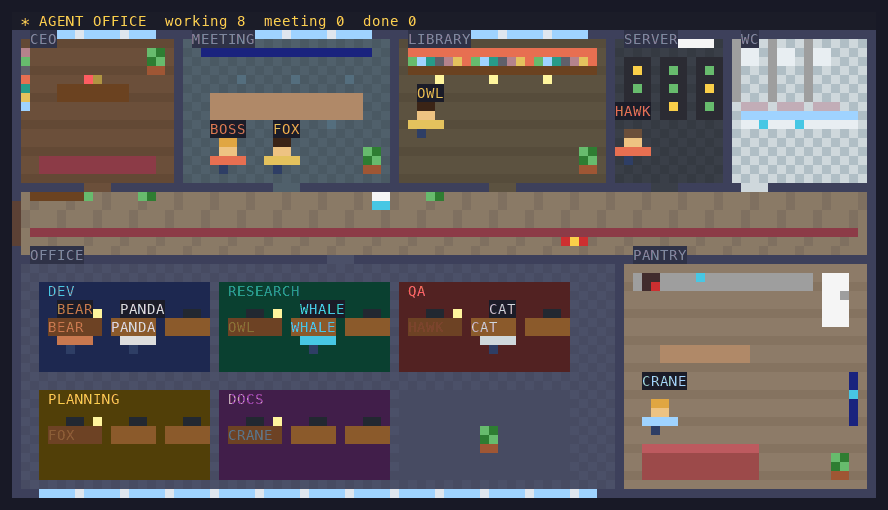
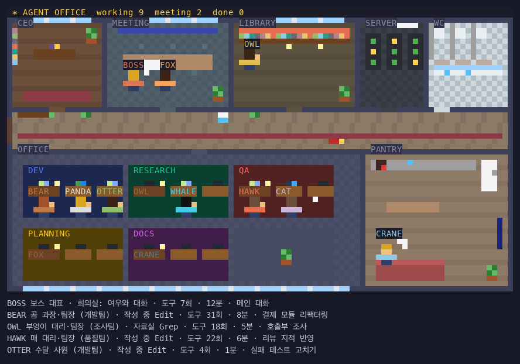

# agent-office

**한국어** | [English](README.en.md)

Claude Code에서 서브에이전트들이 일하는 모습을 **위에서 내려다본 게임 속 사무실**로 보여 주는 mod입니다.
부서·직급·연봉·성과 평가로 이루어진 인사 제도가 있고, 부서가 반복한 실수를 다음 업무 지시에 알려 줍니다.



메인 대화(BOSS)와 기획팀 FOX가 회의실에서 대화하고, 부엉이는 자료실에서 Grep, 매는 서버실에서 테스트를 돌린 뒤 자리로 돌아와 고치고, 늦게 출근한 수달이 입구에서 걸어 들어와 개발팀 자리에 앉습니다. 두루미는 일을 기다리며 탕비실 소파에 있습니다.



## 설치

터미널 세션의 프롬프트에서:

```
/plugin install agent-office --marketplace hyuny0219/agent-office
```

`Add marketplace?`에 `y`, 범위는 **user**(모든 세션)를 고르면 그 세션부터 바로 동작하고, 이후 새로 여는 모든 세션에서 동작합니다.

셸에서:

```
claude plugin install agent-office --marketplace hyuny0219/agent-office
```

데스크톱 앱(`/plugin`이 없는 곳): 프롬프트 옆 + → Plugins → Add marketplace에 `hyuny0219/agent-office` → Add plugin.

## 쓰는 법

| 명령 | 하는 일 |
| --- | --- |
| `/office` | 사무실 평면도 패널 열기 |
| `/office hr` | 인사 기록: 부서별 직원·직급·연봉·최근 평가·완료/실패·도구 오류·재작업·근태 알림, 부서별 반복 실수 |
| `/office hr <별칭>` | 한 사람의 인사카드: 직급·다음 직급까지 남은 경력, 연봉 내역, 실적, 토큰 누적, 최근 업무 5건, 부서가 반복한 실수 (`bear`, `곰`처럼 영문·한글 어느 쪽으로도, 떠난 직원도) |
| `/office approval on` / `off` | 결재 켜기/끄기(기본 켜짐): 끝낸 일의 보고를 팀장이 결재하고, 확정한 계획에 기획팀장 검토를 붙임 |
| `/office reorg on` / `off` | 조직 개편 켜기/끄기(기본 켜짐): 계속 평가가 나쁜 직원은 권고사직, 오래 일이 없는 직원은 계약 종료 |
| `/office budget [<부서> <달러>\|off]` | 부서별 하루(최근 24시간) 비용 한도 보기·정하기·없애기 (예: `/office budget 개발팀 5`) |
| `/office report [today\|week]` | 일간(최근 24시간, 기본)·주간(최근 7일) 보고: 전체·부서별 실적, 근무 시간과 인건비, 토큰 사용량(부서별·많이 쓴 직원), 결재 집계와 결재자별 정확도, MVP, 살펴볼 일(실패·테스트 실패 완료·재작업·근태 알림·결재 반려) |
| `/office hr on` / `off` | 업무 지시에 인사 메모, 연발·제자리걸음 때 근태 알림 붙이기 켜기/끄기(기본 켜짐) |
| `/office hr ab on` / `off` | 교육 효과 측정(실수 목록을 빼고 보내는 비교군 두기) 켜기/끄기(기본 켜짐) |

평면도는 터미널에서 픽셀로 그려지고(폭 72~140칸, 높이 27줄), 데스크톱·VS Code에서는 목록만 나옵니다.

패널 위의 메뉴(`1` 인사 명부 · `2` 일간 보고 · `3` 주간 보고 · `4` 예산)를 누르거나, 직원 줄을 누르면(그 직원의 인사카드) 같은 내용이 메인 채팅창에 흐린 알림 줄로 한 줄씩 남습니다. 보고서·명부·인사카드·예산은 칸을 맞춘 표로 나옵니다. 알림은 사람만 보고 모델은 읽지 않습니다. `5` 설정을 펼치면 결재·조직 개편·인사 메모·교육 효과 측정을 패널에서 바로 켜고 끕니다. 단축키는 패널에 포커스가 있을 때 듣습니다.

## 사무실

- 위층: 사장실, 회의실, 자료실, 서버실, 화장실 / 가운데 복도(입구·안내 데스크·정수기·자판기) / 아래층: 부서별 책상 섬, 탕비실
- 일하는 모습은 실제 그대로입니다.
  - 작성·웹·생각 → 자기 부서 책상(모니터가 하는 일에 따라 깜빡임)
  - Read·Grep 등 읽기 → 자료실, Bash → 서버실
  - 서로 대화할 때(띄우며 지시, `SendMessage`, 끝내고 보고) → 회의실에 모여 말풍선
  - 기다리는 동안(대기) → 탕비실·소파·화장실
  - 완료 → 보고 뒤 입구로 퇴근
- 새 에이전트는 입구에서 걸어 들어오고, 방을 옮길 때 복도를 걸어갑니다. 메인 대화는 `BOSS`, 서브에이전트는 동물 별칭(OWL, BEAR, HAWK…)을 받습니다.

### 사내 대화

- **말풍선**: 머리 위에 3.5초쯤 짧은 말이 뜹니다. 평면도 글자는 영문뿐이라 말풍선도 영문입니다.
  - 혼잣말(회색): `edit hr.ts`, `$ npm test`, `grep foo`
  - 대화(검정): 지시 `BEAR, go!` → `yes!`, 메시지 `-> OWL`, 보고 받기 `thanks!`
  - 보고(초록) `done!`, 실수(빨강) `oops!`
- **사내 메신저**: 평면도 아래에 최근 5줄이 한글로 남습니다.
  - `12초 전 BOSS → BEAR (지시): T139 빌드 — 만들어`
  - `BEAR (혼잣말): 테스트 돌려 보기`: Bash 명령에 붙은 설명
  - `BEAR: 앗, Edit 실패 — …`
  - `OWL → BEAR (메시지): …`
  - `BEAR → BOSS (보고): 고쳤습니다…`
  - `대표 BOSS (결재): BEAR "고치기" 반려 — …`
- 메신저와 말풍선은 터미널 제어 문자를 지우고, 토큰·키·암호처럼 보이는 값은 `***`로 가립니다. Bash 말풍선에는 명령 이름만 싣습니다. 메신저는 세션 상태(`agent-office.feed`)라 같은 세션의 다른 mod도 읽을 수 있습니다.
- 결재에 쓰는 지시·보고 원문은 패널 상태가 아니라 mod 안에만 둡니다. 그래서 mod를 다시 불러오면 그전에 시작한 일은 보고 없이 끝난 것으로 보여 결재가 보류됩니다.

## 인사 제도

- **부서**: 에이전트 종류로 정합니다(개발팀·조사팀·품질팀·기획팀·문서팀·지원팀).
- **직원**: 같은 별칭이 한 사람입니다. 기록은 세션을 넘어 남습니다.
- **배정**: 일이 생기면 그 부서에서 쉬고 있는 직원 중 **적임자**가 맡고, 없으면 채용합니다. 적임자는 평균 평가에 비슷한 일(업무 설명의 낱말이 절반 이상 겹침)을 잘 끝낸 건당 +3(3건까지), 비슷한 일에서 반려·재작업·실패한 건당 −4(2건까지), 경력(최대 +2)을 더해 고릅니다. 고를 사람이 둘 이상이면 까닭("비슷한 일 2건을 잘 끝냄")이 업무 지시 메모와 메신저 지시 줄에 붙습니다.
- **평가**: 실제 기록으로만 매깁니다. 완료 +10, 실패 −5(중단 −3), 도구 오류·거절 1개당 −1(최대 −5), 도구를 써서 오류 없이 완료 +3 → S·A·B·C·D.
  - **검증 실패**: 마지막 테스트·빌드 명령(`npm test`, `tsc`, `pytest` 등. `grep` 같은 다른 명령은 보지 않음)이 실패한 채 완료하면 −4.
  - **재작업**: 끝낸 지 10분 안에 BOSS가 그 직원이 고친 파일을 다시 고치면, 그 일의 점수에서 −4(한 일당 한 번).
  - 평균 평가는 최근 일에 무게를 둡니다(최근 한 건이 30%).
- **직급**: 경력 점수로 사원 → 대리(20) → 과장(60) → 차장(120) → 부장(200). 감점을 받으면 경력도 깎여 강등될 수 있습니다. 부서에서 경력 1위가 팀장입니다.
- **연봉**: 직급 기본급 + 평균 평가 성과급 + 팀장 수당.

### 근태

일하는 모습에서 이상 징후를 찾아 토스트로 알리고, 인사 기록에 근태 알림 횟수를 남깁니다(점수는 깎지 않음).

- **같은 실수 연발**: 같은 도구에서 같은 오류(경로·숫자만 다른 것 포함)가 3번 연달아 나면. 도구마다 따로 세서 사이에 다른 도구를 써도 이어 세고, 그 도구가 성공하면 끊습니다. Bash는 명령 이름으로 가르고(`grep`의 일치 없음과 `npm test` 실패는 다른 실수), 사용자·권한 거절은 세지 않습니다.
- **제자리걸음**: 같은 도구를 같은 입력으로 4번 연달아 부르면(`TaskGet`·`Monitor`처럼 상태를 묻는 도구는 뺌).
- **야근**: 한 일을 20분 넘게 붙잡고 있으면 한 번 알리고, 목록에 `야근`을 붙입니다.

`/office hr on`이면 연발·제자리걸음 때 **그 직원이 도구 결과 뒤에 읽는 짧은 알림**도 붙입니다. 같은 방법을 그만두고 다른 길을 찾거나, 막혔으면 보고하고 끝내라는 내용입니다.

### 업무 지시에 붙는 인사 메모

`/office hr on`(기본)이면 서브에이전트가 뜰 때 업무 지시 끝에 짧은 메모가 붙습니다.
**이 메모는 실제 프롬프트에 들어가므로 에이전트의 동작에 영향을 줍니다.**

```
[사내 인사 메모 · agent-office]
담당: 개발팀 BEAR 대리 (팀장 OWL 과장). 지난 기록: 완료 5 · 실패 1 · 도구 오류 6, 최근 평가 A.
개발팀이 최근 반복한 실수입니다. 이번에는 피하세요:
- Edit "String to replace not found in file." 3회 → Edit 전에 바꿀 부분을 Read로 다시 읽어 원문을 그대로 옮긴다
평가 기준: 맡은 일을 끝까지 완료할 것, 도구 오류를 줄일 것, 실패한 테스트·빌드를 두고 끝내지 말 것. 끝낼 때 한 일·확인한 것·남은 위험을 짧게 보고할 것.
```

반복한 실수는 서브에이전트의 도구 오류 문구를 부서별로 묶어 센 것(경로·숫자는 지움)이고, 2회 이상인 것 중 최근에 난 것부터 최대 3개 붙습니다. 2주 넘게 다시 나지 않은 실수는 붙이지 않습니다.
끄려면 `/office hr off`. 꺼도 평가·연봉 기록은 계속 남습니다.

### 결재

도구 호출은 하나도 막지 않습니다. 결재 대상은 **끝낸 일의 보고**와 **확정한 계획**입니다.

- **보고 결재**: 서브에이전트가 일을 마치면 그 부서 팀장이 지시·보고·기록(도구 오류, 테스트·빌드 실패, 근태 알림)을 보고 승인하거나 반려합니다. 팀장이 본인이거나 없으면 대표(BOSS)가 결재합니다.
- **전결**: 과장 이상이 올린 보고나 도구를 3번도 안 쓴 짧은 일은 결재 없이 넘어갑니다.
- **반려**: 보완할 점이 토스트로 뜨고, 메인이 그 보고를 받을 때(백그라운드 일이면 다음 도구 결과 뒤에) 함께 읽습니다. 다시 맡길지는 메인이 정합니다. 반려되면 그 일의 평가가 -3, 인사카드·보고서에 반려로 남습니다.
- **계획 검토**: 메인이 계획을 확정하면(ExitPlanMode) 기획팀장이 검증 단계·범위·위험·부서가 반복한 실수 대비를 봅니다. 보완이 필요하면 의견만 붙이고 막지는 않습니다.
- 결재자는 값싼 모델(haiku)이 맡아 결재 한 건마다 한 번 부릅니다(8초 제한, 처음 부를 때 한 번 안내). 모델이라 틀릴 수 있고, 보고 없이 끝났거나 답하지 못하면 보류로 두고 점수에 반영하지 않습니다. 비용이 싫으면 `/office approval off`.
- **결재 정확도**: 결재가 맞았는지는 끝낸 뒤 10분 안에 **다른 사람(BOSS나 다른 직원)이 같은 파일을 고쳤는지**로 잽니다. 승인했는데 고쳐지면 놓친 승인, 반려했는데 아무도 안 고치면 빗나간 반려입니다. 고친 파일이 없는 일(조사·문서 읽기)은 잴 수 없어 빼고, 결재자별로 `/office report`에 싣습니다. 판정된 반려가 3건 이상인데 맞은 것이 1/3 아래인 결재자의 반려는 **감점하지 않고**, 적임자를 고를 때도 그르친 일로 치지 않습니다(의견은 그대로 메인에게 갑니다). 같은 직원이 다음 일에서 제 파일을 더 고친 것은 후속 수정으로 치지 않습니다. 후속 수정이 다음 단계 작업일 수도 있어 거친 잣대입니다.

### 조직 개편

`/office reorg on`(기본)이면 일이 끝나 평가·결재가 다 끝난 뒤, 그리고 세션을 열 때 직원 명부를 봅니다. 지금 일하는 직원, 일을 배정받아 들어오는 중인 직원, 평가·결재가 덜 끝난 직원은 건드리지 않습니다. 처음 내보낼 때 한 번 안내합니다.

- **권고사직**: 업무 5건 이상인데 최근 평균 평가가 0 아래(D)면.
- **계약 종료**: 업무 2건 이하로 30일 넘게 일이 없으면.

떠난 직원은 토스트와 메신저(인사팀 발령)로 알리고, `/office hr`의 떠난 직원 목록과 인사카드(`/office hr <별칭>`)에 남습니다. 떠난 직원의 별칭은 다시 쓰지 않고(기록이 섞이지 않도록), 떠난 뒤에 그 직원의 일이 끝나 들어오면 새로 뽑지 않고 복직시킵니다. 부서는 에이전트 종류로 정해지고 직원은 제 부서 일만 맡으므로, 다른 부서 일을 더 잘하는지 알 수 없어 부서 이동은 하지 않습니다.

### 보고서

`/office report`는 끝낸 일 기록(최근 300건)으로 만듭니다. 시간대를 모르므로 "오늘"은 최근 24시간, "이번 주"는 최근 7일입니다. 인건비는 직원의 지금 연봉을 시급(주 40시간 × 52주)으로 바꿔 걸린 시간에 곱한 장난스러운 숫자입니다.

### 토큰 사용량과 비용

에이전트가 모델을 부를 때마다 엔진이 알려 주는 사용량(입력·출력·캐시 읽기·캐시 쓰기)과, 그 모델의 Anthropic API 정가로 어림한 비용(달러)을 그 에이전트에게 더합니다. 캐시 쓰기는 입력 가격의 1.25배(5분 캐시)로 치고, 하이쿠 5.5의 긴 프롬프트 할증과 배치·지역 가격은 반영하지 않습니다. 가격표에 없는 모델의 토큰은 비용에 넣지 않고 "가격 모름"으로 따로 적습니다(v0.10에서 센 토큰도 모델을 몰라 여기에 듭니다). 구독 요금제라면 실제로 내는 돈이 아니라, 같은 일을 API로 했을 때의 값입니다. 패널 목록 줄에 지금 일의 토큰이 보이고(BOSS는 이 세션 동안 쓴 것), 일이 끝나면 그 일 기록과 직원 누적에 남아 `/office hr`(누적)·`/office hr <별칭>`(네 가지 내역·한 건 평균·최근 업무별)·`/office report`(전체·부서별·많이 쓴 직원 세 명)에 실립니다. 결재자가 그 일을 결재하며 쓴 토큰은 업무 토큰과 따로 "결재"로 셉니다. 적는 수는 네 가지를 모두 더한 것이라 캐시 읽기가 큰 몫을 차지합니다(값이 싼 토큰이니 비용은 괄호 안의 달러를 보세요). BOSS의 토큰은 패널에만 보이고 인사 기록에는 남지 않습니다. 패널 줄에는 그 직원이 쓰는 모델도 짧게 보입니다(마지막으로 답한 모델, 예: `Opus 5.5`). 줄이 터미널 폭을 넘으면 덜 중요한 칸부터 줄이거나 뺍니다: 말풍선 인용 → 도구 수 → 걸린 시간 → 토큰(비용만 남김) → 한글 별명 → 오류 수 → 비용 → 모델. 누구·어디서·근태 경고·맡은 일은 늘 남깁니다. 계획 검토에 쓴 토큰은 어느 일의 것도 아니어서 세지 않고, 끝난 뒤 이어서 돈 에이전트의 토큰도 세지 않으며, 이 기능 전에 끝낸 일에는 토큰이 없습니다.

### 부서 예산

`/office budget 개발팀 5`처럼 부서마다 하루 비용 한도(달러)를 둘 수 있습니다. 최근 24시간에 끝낸 그 부서 일의 비용(일한 것과 그 일의 결재)과 지금 일하는 직원이 쓴 비용을 더해, 한도를 넘으면 토스트와 메신저(인사팀)로 알립니다. 같은 부서는 24시간에 한 번만 알리고, 한도를 새로 정하면 다시 알릴 수 있습니다. 알리기만 하고 일을 막지는 않습니다. 현황은 `/office budget`과 일간 보고(`/office report`)에, 정해 둔 한도는 `/office hr`에 나옵니다. 부서는 `개발팀`, `개발`, `dev` 어느 쪽으로도 씁니다. BOSS가 쓴 비용은 부서가 없어 어느 예산에도 들지 않습니다.

### 교육 효과 측정

메모에 붙이는 실수 목록이 정말 재발을 줄이는지 잽니다.

- 실수 목록을 붙일 업무 **5건에 한 건은 목록만 빼고** 보냅니다(비교군). 메모의 나머지는 같습니다.
- 일하는 동안 그 실수가 다시 나면 재발로 적고, 끝나면 실수마다 메모군·비교군의 재발률을 쌓습니다. `/office hr`에 `측정 중: 메모 8건 중 재발 1(13%) / 비교군 3건 중 재발 2(67%)`처럼 나옵니다.
- 메모군 10건·비교군 5건이 모이고 비교군에서 2번 이상 재발해야 판정합니다(드문 실수를 근거 없이 빼지 않도록). 그때 메모를 붙여도 재발률이 낮지 않으면 **효과 없음**으로 보고 **2주 동안** 메모에서 뺐다가, 그 뒤 처음부터 다시 잽니다.
- 비교군을 두고 싶지 않으면 `/office hr ab off`. 빼 두었던 실수도 다시 붙고, 쌓인 기록은 남습니다.

## 설정

`/config`의 agent-office 항목:

| 항목 | 설명 |
| --- | --- |
| `attachTo` | 다른 mod가 여는 사이드 패널의 id. 적으면 그 패널 아래에도 평면도를 붙입니다(사이드 패널은 한 번에 한 탭만 보이므로, 다른 패널과 위아래로 함께 보고 싶을 때). 비우면 `/office` 패널에만 그립니다. |

## 개발

```
claude plugin validate .
claude plugin test .
claude --plugin-dir .
```

`hooks/register.tsx`는 엔진의 사건을 잇기만 하고, 일은 나눠 둡니다: `store.ts`(상태·저장), `flow.ts`(동기화·평가·결재·근태·조직 개편), `view.ts`(패널 줄·평면도 칠하기), `commands.ts`(`/office` 글 답), `menu.ts`(패널 메뉴: 누르면 채팅창에 알림), `table.ts`(칸 맞춤 표). 판단은 순수 함수 모듈이 합니다: `hr.ts`(인사), `org.ts`(배정·결재 정확도·조직 개편), `approval.ts`(결재), `speech.ts`(대화), `report.ts`(보고서·명부·인사카드), `tokens.ts`(토큰 사용량·비용), `budget.ts`(부서 예산), `trial.ts`(교육 효과), `watch.ts`(근태), `scene.ts`(평면도).

README 스크린샷(`docs/office.png`, `docs/office.gif`)은 `hooks/scene.ts`를 그대로 돌려 만듭니다(Pillow 필요).

```
npx tsx scripts/screenshot-frames.mts > /tmp/frames.json
python3 scripts/render-screenshot.py /tmp/frames.json docs
```

## 라이선스

[MIT](LICENSE)
